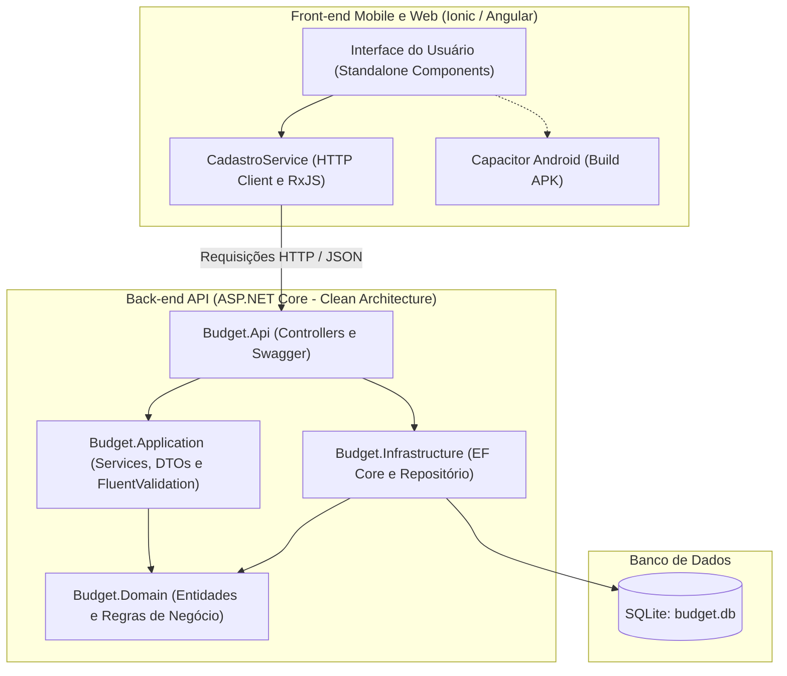

# 🏍️ MotoBudget - Sistema de Gestão de Orçamentos para Oficinas de Motos

<p align="center">
  
  
  
  
  
  
  
</p>

> 🎓 **Projeto de Conclusão de Curso (TCC)**  
> **Curso:** Técnico em Informática com Ênfase em Programação  
> **Tema:** Aplicativo Móvel Híbrido e Web API para Gestão e Orçamentos de Peças e Serviços em Oficinas de Motocicletas.

---

## 📌 1. Sobre o Projeto

O **MotoBudget** é uma solução completa desenvolvida para suprir a necessidade de oficinas mecânicas de pequeno e médio porte no gerenciamento de orçamentos preliminares e ordens de serviço.

Tradicionalmente, orçamentos nesse segmento são realizados em cadernos de papel ou blocos de notas, sujeitos a rasuras, erros em somatórias manuais de peças e perda do histórico. O MotoBudget resolve esse problema permitindo:
- **Cadastro Ágil:** Registro imediato da motocicleta e de seus respectivos itens/serviços.
- **Cálculo em Tempo Real:** Atualização automática do valor total à medida que serviços e peças são inseridos com preço e quantidade.
- **Armazenamento Seguro:** Persistência em banco de dados relacional via API RESTful.
- **Mobilidade:** Acesso direto do celular Android na bancada da oficina ou via navegador desktop.

---

## 🏛️ 2. Arquitetura do Sistema

A aplicação foi projetada no modelo **Cliente-Servidor desacoplado**, com o front-end consumindo a API por meio de requisições HTTP REST:



---

## 🛠️ 3. Tecnologias e Padrões Utilizados

### Front-end (Mobile & Web)
- **[Ionic Framework 8](https://ionicframework.com/):** Componentes visuais móveis (cards, badges, botões, modais).
- **[Angular 17+](https://angular.dev/):** Estrutura SPA com componentes *standalone*, diretivas e injeção de dependências.
- **[Capacitor 6+](https://capacitorjs.com/):** Ponte nativa para compilação e execução em dispositivos Android.
- **[TypeScript](https://www.typescriptlang.org/):** Tipagem estática para maior previsibilidade e segurança no código.
- **[RxJS](https://rxjs.dev/):** Manipulação de fluxos assíncronos e chamadas HTTP.

### Back-end (API & Banco de Dados)
- **[.NET 10 / ASP.NET Core Web API](https://dotnet.microsoft.com/):** Back-end compilado, de alta performance e escalável.
- **Clean Architecture (Arquitetura Limpa):** Separação em camadas estritas (`Domain`, `Application`, `Infrastructure`, `Api`).
- **Entity Framework Core (EF Core):** Mapeamento Objeto-Relacional (ORM) e gestão de migrações estruturais (*Migrations*).
- **SQLite:** Banco de dados relacional leve e embutido em arquivo local (`budget.db`).
- **FluentValidation:** Validações de entrada desacopladas dos modelos da API.
- **Swagger / OpenAPI:** Documentação e console interativo para testes de rotas.

---

## 📂 4. Estrutura do Repositório

```text
meuApp/
├── back-end/
│   └── src/
│       ├── Budget.Domain/           # Entidades (Budget), Exceções e Interfaces
│       ├── Budget.Application/      # DTOs, Serviços de Casos de Uso e Validações
│       ├── Budget.Infrastructure/   # DbContext do EF Core, Repositório e SQLite
│       └── Budget.Api/              # Controllers, Program.cs e Swagger
│
├── src/
│   ├── app/
│   │   ├── principal/               # Tela inicial com listagem e resumo de valores
│   │   ├── home/                    # Tela de cadastro/edição dinâmica de orçamentos
│   │   ├── anotacoes/               # Bloco de recados e anotações rápidas
│   │   └── services/
│   │       └── cadastro.service.ts  # Comunicação com a API e adaptador de dados
│   ├── environments/                # Configuração de URL da API (rede local/produção)
│   └── theme/                       # Estilização global e variáveis SCSS
│
├── android/                         # Projeto nativo gerado pelo Capacitor
├── capacitor.config.ts              # Configurações do Capacitor
├── angular.json                     # Configurações do ecossistema Angular
└── package.json                     # Dependências do front-end
```

---

## 🌐 5. Endpoints da API REST

Base URL (desenvolvimento local): `http://<SEU_IP_LOCAL>:5042/api/Budget`

| Método | Rota | Descrição | Status Sucesso |
| :---: | :--- | :--- | :---: |
| `GET` | `/api/Budget` | Lista todos os orçamentos cadastrados | `200 OK` |
| `GET` | `/api/Budget/{id}` | Busca os detalhes de um orçamento pelo ID (GUID) | `200 OK` |
| `POST` | `/api/Budget` | Cria um novo orçamento com múltiplos itens | `201 Created` |
| `PUT` | `/api/Budget/{id}` | Atualiza dados e itens de um orçamento existente | `204 NoContent` |
| `DELETE`| `/api/Budget/{id}` | Exclui permanentemente um orçamento | `204 NoContent` |

---

## 🚀 6. Como Executar o Projeto

### Pré-requisitos
- [.NET SDK 10+](https://dotnet.microsoft.com/download)
- [Node.js 18+](https://nodejs.org/) e `npm`
- [Ionic CLI](https://ionicframework.com/docs/cli) instalado globalmente:
  ```bash
  npm install -g @ionic/cli
  ```

---

### Passo 1: Executar o Back-end (.NET API)

1. Entre na pasta da API:
   ```bash
   cd back-end/src/Budget.Api
   ```

2. Execute as migrações para inicializar o banco de dados SQLite:
   ```bash
   dotnet ef database update --project ../Budget.Infrastructure
   ```

3. Inicie a API:
   ```bash
   dotnet run
   ```

> 💡 A API iniciará escutando em `http://0.0.0.0:5042`.  
> Para testar no navegador, acesse o Swagger: **`http://localhost:5042/swagger`**

---

### Passo 2: Executar o Front-end (Ionic / Angular)

1. Em outro terminal, na raiz do projeto (`meuApp`):
   ```bash
   npm install
   ```

2. Verifique o arquivo `src/environments/environment.ts` e informe o IP da sua máquina na rede local:
   ```typescript
   export const environment = {
     production: false,
     apiUrl: 'http://<SEU_IP_LOCAL>:5042/api/Budget'
   };
   ```

3. Inicie o servidor do Ionic:
   ```bash
   ionic serve
   ```

> O aplicativo abrirá automaticamente no navegador em: **`http://localhost:8100`**

---

### Passo 3: Compilar para Android (Opcional)

1. Gere a versão de distribuição do front-end:
   ```bash
   ionic build
   ```

2. Sincronize com o projeto Android:
   ```bash
   npx cap sync android
   ```

3. Abra o projeto no Android Studio:
   ```bash
   npx cap open android
   ```

---

## 🌟 7. Diferenciais Técnicos Apresentados no TCC

- **Arquitetura em Camadas (Clean Architecture):** Garante que a regra de negócio do domínio não dependa de banco de dados, bibliotecas externas ou frameworks web.
- **Modelagem com Entidade Rica:** A classe de domínio `Budget` protege suas propriedades com encapsulamento e métodos de fábrica `Create` e `Update`, validando o estado antes de qualquer persistência.
- **Suporte a Dispositivo Móvel em Rede Local:** Configuração de escuta no host `0.0.0.0` e política de CORS aberta para testes práticos com celular físico conectado no mesmo Wi-Fi.
- **Interface Reativa:** Inclusão e exclusão de itens de serviço na tela com recálculo instantâneo de totais.

---

## 👨‍🎓 Autor
Desenvolvido como projeto de **Trabalho de Conclusão de Curso (TCC)** no **Curso Técnico em Informática com Ênfase em Programação**.
